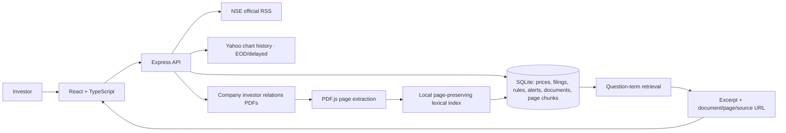

# Architecture

FINN is one local web service with a Vite client and an Express API. SQLite is the durable local store. The product runs without a model key; research is extractive retrieval over downloaded primary documents.

## Data flow

1. `POST /api/refresh` reads NSE's public announcements RSS and sequentially requests Yahoo daily history for the 18 configured `.NS` symbols and any additional tickers with saved rules.
2. Company-name matching associates RSS items with the local universe. Stable SHA-256 IDs deduplicate filings. A deterministic keyword taxonomy assigns category and attention tier.
3. Yahoo observations are upserted by ticker and session date. Thresholds are evaluated only when the newest session is newer than the stored session. Trigger IDs hash rule, session, and event kind.
4. `POST /api/research/ingest/INFY.NS` fetches two verified official PDFs. PDF.js extracts text per page, splits long pages into overlapping chunks, and stores document metadata, source URL, checksum, local ignored file path, page, and chunk ID.
5. `POST /api/research/ask` ranks indexed chunks by query term frequency and returns excerpts with source URLs and PDF page anchors. It labels this as lexical evidence retrieval, not generated analysis. `/api/evidence/:id` resolves a stored chunk.

## Main tables

- `filings`, `prices`, `alert_rules`, `alert_events`, and `refreshes` support Push and EOD monitoring.
- `documents` stores company, type, period, publication date, source link, downloaded path, checksum, page count, and ingestion status.
- `chunks` stores the extracted text with its document ID, PDF page, ticker, and chunk index.

## Deliberate constraints

- No model provider is wired because evidence retrieval is the useful zero-key baseline here. There is no price-prediction model.
- The PULL document-discovery registry currently contains Infosys FY26 and Q2 FY27 source PDFs. Search input accepts another NSE ticker, but FINN does not pretend to have its documents until verified links are added.
- Results-table extraction, quarter comparisons, transcript-vs-subsequent-results scoring, category-specific filing alert rules, and professional biographies are not implemented.
